# Agentic Template

A starting point for any new project built with [Claude Code](https://claude.com/claude-code) using an **agentic SDLC**: a fixed cycle of spec, tests, plan, review, implementation, review and verification, where each step is a focused skill or subagent and deterministic hooks catch what the model forgets.

Clone it, run one setup command, answer a few questions, and the project has a filled-in `CLAUDE.md`, a test baseline (unit, integration, E2E on desktop and mobile, accessibility checks), CI, and self-maintaining docs.

Free and open source (MIT). If it saves you time, a star helps others find it.

<p align="center"></p>

## Quick start

1. Click **Use this template** on GitHub, create your repository, and clone it.
2. Open [Claude Code](https://claude.com/claude-code) in the project and run `/agentic-init`. Answer the questions. It sets up the stack and runs `npm install`, which also turns on the git hooks.

Then build your first feature with `/product <what you want>` and follow [`WORKFLOW.md`](WORKFLOW.md). Optional, once per machine: `node global/install-global.mjs` blocks access to secret files in every project.

**Requirements:** Node.js 22 or later, git, and Claude Code. Each stack profile lists what else it needs (for example Docker for Supabase and Firebase + Postgres, Java for the Firebase emulators). On macOS, if `docker` is not found after installing Docker Desktop, add `$HOME/.docker/bin` to `PATH` in `~/.zshrc`.

## What's inside

```
CLAUDE.md                      Project rules. Filled in by /agentic-init
WORKFLOW.md                    Cheat sheet: the 10-step feature cycle
copy-rules.json                Characters to forbid in user-facing text (empty by default)
docs/                          architecture, design-brief, flows/
feature-index/index.yaml       Feature -> files, data, docs (navigation for the agent)
specs/features/                Spec, plan and test report for each feature
.claude/settings.json          Hooks + deny rules (secrets, deploy, force push)
.claude/hooks/                 protect-files, format-on-edit, optional long-file guard
.claude/skills/                agentic-init, product, architect, dev, qa, design-brief, bootstrap-docs, handoff
.claude/agents/                plan-reviewer (Opus), code-reviewer, security-reviewer (Opus)
.githooks/                     pre-commit (copy rules), post-commit (updates docs + feature index)
scripts/                       check-copy.mjs, update-docs.sh
.github/workflows/ci.yml       Copy check, lint, tests, E2E
global/install-global.mjs      One-time setup for ~/.claude on your machine
```

### Skills (slash commands)

| Skill | What it does |
|---|---|
| `/agentic-init` | One-time setup: interviews you (product, roles, stack, languages, tenancy, accessibility law, PWA) and fills `CLAUDE.md` from a stack profile. Profiles: `static`, `firebase`, `supabase`, `firebase-postgres`. |
| `/product` | Feature request to spec: user stories, numbered acceptance criteria, UI contract (including mobile). |
| `/qa` | Writes Playwright E2E tests from the spec **before** the code exists, then verifies the finished feature. |
| `/architect` | Writes the implementation plan to a file and stops for approval; revises it after plan review. Runs on Opus. |
| `/dev` | Implements an approved plan with unit and integration tests. Runs on Sonnet. |
| `/design-brief` | Interviews you and writes the visual direction and a design tokens file. |
| `/bootstrap-docs` | One-time docs for an existing codebase, using parallel explore subagents. |
| `/handoff` | A short structured report to forward to an outside reviewer. |

### Subagents

- `plan-reviewer` (Opus): checks a plan against the spec, docs and rules before any code is written.
- `code-reviewer`: reviews a commit or PR for correctness, conventions, tests, and whether the docs were updated.
- `security-reviewer` (Opus): authentication, authorization, tenant isolation, personal data, secrets.

### Hooks

- **Claude Code:** blocks any access to `.env`, keys and service-account files; formats edited files with Prettier; checks copy rules after every edit.
- **Git:** pre-commit enforces the copy rules; post-commit runs headless Claude to update `docs/` and `feature-index/index.yaml` in a separate `docs:` commit.

## One-time setup per machine

```bash
node global/install-global.mjs
```

Adds the secret-file guard to `~/.claude/settings.json` for every project, and on macOS a sound when Claude needs you (if you don't have one). It backs up the file first and is safe to run again.

Also once per machine, so references to deleted branches are cleaned on every pull:

```bash
git config --global fetch.prune true
```

And once per repository on GitHub: Settings -> General -> Pull Requests -> **Automatically delete head branches**.

## New project

1. On GitHub: **Use this template** -> new repository -> clone it.
2. In Claude Code: `/agentic-init`, and answer the questions. It runs `npm install` at the end, which installs the git hooks.
3. Review the changes and commit them on a branch.
4. `/design-brief`.
5. First feature: follow `WORKFLOW.md`.

## Working on an existing clone

When you clone a project that was already set up (a teammate, or you on another computer), run `npm install` first. It installs the app's dependencies and turns on the git hooks through the `postinstall` script (`git config core.hooksPath .githooks`). Git does not run hooks stored in a repository on its own, so without this step the copy check and the automatic docs update silently stop running.

Then create your local config once: `cp .env.example .env` (the example holds local, invented development values). Profiles with a local database also need `npm run db:up` before the database tests.

## Project in a client's repository

When the client must own the code, they create an **empty** repository in their GitHub organization and give you Admin access to it. "Use this template" does not work there, because you cannot create repositories in their organization.

**The client** (signed in to the company's GitHub account):

1. If there is no organization yet: `+` at the top -> New organization -> Free -> organization name and a company contact email -> "A business or institution" with the company's legal name.
2. In the organization: New repository -> name -> **Private** -> no README, no `.gitignore`, no license -> Create repository.
3. In the repository: Settings -> Collaborators and teams -> Add people -> `<your GitHub user>` -> Role: **Admin** -> Add.

**You:** accept the invitation (email or https://github.com/notifications), then copy the template with a fresh history:

```bash
git clone --depth 1 https://github.com/amirtat/agentic-template.git <project>
cd <project>
rm -rf .git
git init -b main
git add .
git commit -m "Initial commit from agentic template"
git remote add origin https://github.com/<client-org>/<repo>.git
git push -u origin main
```

- The result is the same as "Use this template": one commit, no template history.
- This is the only push that goes straight to `main`, because the repository is empty. From then on, work on branches.
- Continue from step 2 of "New project". (If you commit before running `/agentic-init`, run `npm install` first so the git hooks are on.)
- Agree with the client on who owns the tooling (`.claude/`, `.githooks/`, `scripts/`). This template is MIT licensed, so either way works.
- **Google Cloud in the client's organization.** When the client's Google account belongs to their Google Workspace, the organization policy usually blocks granting project roles to an outside address (`IAM policy update failed ... Domain Restricted Sharing`). The client's Workspace admin can lift it for this one project only, in Cloud Shell with the project selected:

  ```bash
  cat > policy.yaml <<'EOF'
  name: projects/<project-id>/policies/iam.allowedPolicyMemberDomains
  spec:
    rules:
    - allowAll: true
  EOF
  gcloud org-policies set-policy policy.yaml
  ```

  Newer organizations may also enforce `iam.managed.allowedPolicyMembers`; turn its enforcement off for the project the same way (Console: IAM & Admin -> Organization Policies -> the policy -> Manage policy -> Override parent's policy). Check both with `gcloud org-policies describe <policy> --project=<project-id> --effective`, then grant the roles with `gcloud projects add-iam-policy-binding`. The rest of the organization stays restricted.
- On GitHub's free plan, a private repository has no branch protection rules and no CodeQL code scanning. The rule "never push to `main` without approval" is then enforced only by the hooks and by you. For code scanning on a free private repository, Semgrep in CI is a free alternative.

## Existing project

On a new branch, copy `.claude/`, `.githooks/`, `scripts/`, `feature-index/`, `specs/`, `copy-rules.json`, and `CLAUDE.md` (only if the project has none). Then run `/agentic-init`, then `/bootstrap-docs`.

## Rules every project gets

- **Fully responsive:** every screen works at 375px wide; E2E runs on desktop and mobile.
- **Any language, either direction:** the primary language and its direction are set at init. Logical CSS properties only, all user-facing text in one strings file.
- **Accessible:** WCAG 2.1 AA, plus the local law for your users' country (for example EN 301 549, ADA and Section 508, Israeli Standard 5568). Semantic HTML, keyboard, contrast, and an automatic axe check on every screen in E2E. Public apps can get an accessibility statement page.
- **Installable (PWA):** optional. `/agentic-init` asks, and adds it from `pwa.md` if you say yes.
- **Copy rules:** optional. Forbid characters such as the em dash in user-facing text; enforced after every edit, in pre-commit and in CI.
- **No deploy and no push** without explicit approval. CI must be green first.
- **No secrets in code.** Claude is blocked from reading `.env`.

## Credits

This template started from the demo kit of the course **AI for Developers with Claude Code** at [Elevation](https://elevation.education), by [Nir Channes](https://www.linkedin.com/in/nirch/), and is shared with his permission. From the course kit come the core of the `product`, `dev` (now split into `architect` and `dev`) and `qa` skills, the `plan-reviewer` and `code-reviewer` agents, the post-commit docs hook, and the shape of `CLAUDE.md`.

Added on top of it:

- `/agentic-init` with four stack profiles (static, Firebase, Supabase, Firebase + Postgres), including multi-tenant rules
- The `security-reviewer` agent, and a docs check in `code-reviewer`
- The feature index, maintained by the docs hook
- Hooks that block secret files, format every edit and enforce copy rules; deny rules for deploy and force-push
- CI, and a one-time global installer
- Product rules for every app: mobile, any language and direction, accessibility with axe in E2E, optional PWA
- The `/design-brief`, `/bootstrap-docs` and `/handoff` skills
- Changes to the course skills: mobile in the UI contract and E2E, a single strings file, and copy rules
- Planning split from implementation (`/architect` on Opus, `/dev` on Sonnet), with a model set per skill and agent

## Contributing

Improvements to a skill, agent or hook that proved themselves in a real project are welcome as pull requests.

## License

[MIT](LICENSE)
